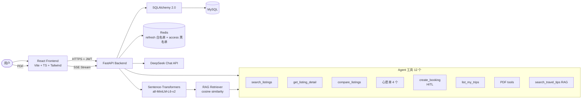
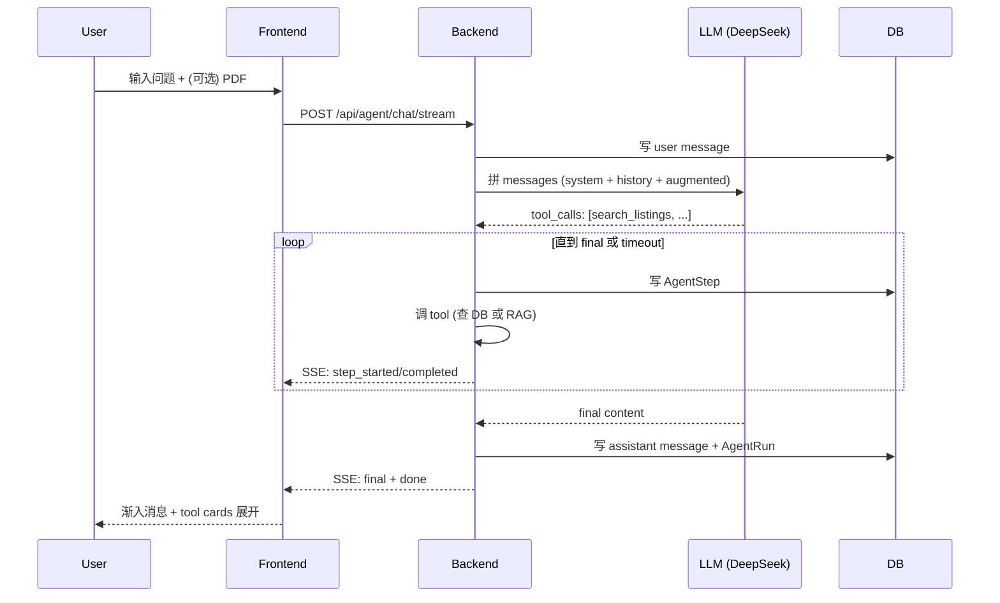

# StayAgent

> **Airbnb 风格住宿平台 × AI Travel Agent**
> Agent 能真正帮你订房 — 不只是聊天，能调工具、改数据、影响实际业务流程

立项文档见 `docs/project-charter.md`（本地参考用，不上传 git）。

---

## 📍 项目板块（25 项全部完成 ✅）

| Block | 内容 | 加分项覆盖 |
|---|---|---|
| 1 | 项目骨架 + Hello StayAgent | F1, B1, B2 |
| 2 | 用户系统 | B4, F3 |
| 3 | Listing seed 数据 | B8 |
| 4-7 | 首页 / 搜索 / 详情 / 心愿单 / Trips | F2, F4, F6 |
| 8 | LLM 客户端 + 12 Tool Schema | A1 |
| 9 | Agent Orchestrator + 7 Tool | A10 |
| 10 | AgentPanel UI + SSE 流式 | A2, F7 |
| 11 | AgentPanel 重构 (浮动+全屏+历史) | A4, A5, A8 |
| 11.5 | create_booking (HITL) + 拖动 + 全屏微调 | A9 |
| **12** | **Tools 9-12 + RAG (Travel Tips) + PDF 上传** | **A3, A6, A7** |
| **13** | **F5 动画 + F8 Generative UI + 演示文档** | **F5, F8** |

---

## 🏛️ 架构总览



---

## 🔄 Agent 调用流程



HITL 例外：`create_booking` 触发时返回 `status=pending_confirmation`，前端渲染 `AgentConfirmCard`，用户点确认后调 `/api/agent/runs/{id}/confirm`。

RAG 流程：`search_travel_tips(query)` → `embed(query)` → 全表 cosine similarity → top-3 tips → LLM 二次组织成中文回答。

---

## 🚀 快速开始

### 安装

```bash
make install            # uv sync + pnpm install
```

### 配置环境

编辑 `backend/.env`，填入 MySQL 密码和 DeepSeek API key。

### Seed 演示数据

```bash
make seed                                  # 100 条房源 (10 城 × 10 条)
uv run python -m scripts.seed_travel_tips  # 30 条 RAG 知识库 (5 类 × 6 条)
```

### 启动

```bash
make dev      # 同时启动前后端
```

- 🎨 前端：<http://localhost:5173>
- 🚀 后端：<http://127.0.0.1:8000>
- 📚 API 文档：<http://127.0.0.1:8000/docs>

---

## 🧪 验证

```bash
# 后端 unit tests
cd backend
uv run python -m scripts.test_agent_block11_5    # 5/5
uv run python -m scripts.test_agent_block12      # 10/10

# 前端 build
cd ../frontend
pnpm exec tsc --noEmit
pnpm run build
```

---

## 🎬 演示脚本

详见 **[docs/demo.md](docs/demo.md)** — 5 分钟答辩脚本。

---

## 🔑 关键技术决策

| 决策 | 替代方案 | 为何选这个 |
|---|---|---|
| **uv** (Rust 写的 pip) | pip + venv | 快 10-100×，自动管虚拟环境 |
| **pnpm** | npm / yarn | 速度快、磁盘省、monorepo 友好 |
| **Sentence-Transformers** (本地 RAG) | 云 embedding API / LangChain | 0 成本、不引依赖、规模 30 条足够 |
| **DeepSeek** | OpenAI / Claude | 中文强、价格低、OpenAI 协议兼容 |
| **手写 ReAct** | LangChain / LlamaIndex | 透明可控，无黑盒 |
| **MySQL** + SQLAlchemy 2.0 | Postgres / MongoDB | 项目 ORM 基础 |
| **Redis 黑名单** | JWT-only | 即时撤销 access token，无需等过期 |
| **PDF inline 注入** | file_id 引用 | LLM 直接读，避免幻觉参数 |

---

## 📦 项目结构

```
stayagent/
├── backend/
│   ├── app/
│   │   ├── api/         # HTTP 路由 (auth/listings/bookings/wishlists/agent/uploads)
│   │   ├── core/        # llm_client / redis_client / security
│   │   ├── db/          # SQLAlchemy Base + Session
│   │   ├── models/      # 9 张表
│   │   ├── schemas/     # Pydantic schemas
│   │   └── services/
│   │       ├── agent/   # orchestrator / tools / tool_schemas / prompts / retry
│   │       └── rag/      # Block 12: sentence-transformers + cosine
│   ├── scripts/         # seed_listings / seed_travel_tips / test_block_*
│   └── pyproject.toml
├── frontend/
│   ├── src/
│   │   ├── api/         # axios + uploads + agent
│   │   ├── components/  # 33+ 组件 + agent/ 子目录 (F8)
│   │   ├── views/       # 7 页面
│   │   ├── stores/      # auth / wishlist / agent / toast (zustand)
│   │   ├── hooks/ / lib/ / types/ / router/
│   │   └── index.css
│   └── tailwind.config.js
├── docs/
│   ├── CHANGELOG.md
│   ├── CONSTITUTION.md
│   ├── project-charter.md
│   ├── demo.md             # Block 13: 5 分钟演示脚本
│   ├── architecture.md     # Block 13: 架构详解
│   └── screenshots/        # Block 13: 截图占位
├── Makefile
└── README.md
```
