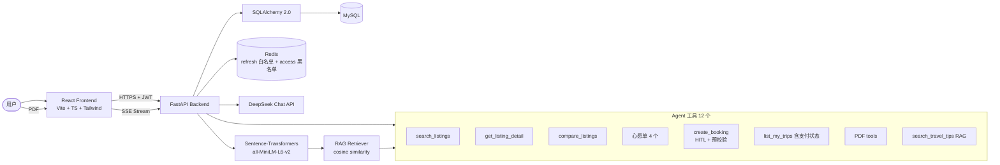

# StayAgent

> **Airbnb 风格住宿平台 × AI Travel Agent**
> 不只是聊天 —— Agent 能真正调工具、下订单、走支付，影响实际业务流程

FastAPI + React 双端全栈项目：房客端覆盖搜索/预订/模拟支付/行程管理，房东端覆盖房源发布/订单管理/房态日历，AI Agent 通过 12 个工具 + ReAct 循环帮用户完成"搜房 → 比价 → 下单 → 支付"全链路。

---

## ✨ 功能总览

### 🧳 房客端
- **搜索与筛选**：50 城 1000+ 房源，DB 端过滤（价格直方图/设施多选/房型/卧室数），分页 + 地图（Leaflet + OSM）
- **预订与模拟支付**：待支付订单 15 分钟倒计时，三种支付方式（支付宝/微信/卡），支付成功自动确认；超时自动作废
- **订单管理**：行程页（有效订单）+ 已取消专页，取消原因可追溯（你主动取消 / 房东取消 / 超时未支付）；房东取消后房客页面 30s 内自动感知
- **心愿单**：多清单收藏 + 按名称增删

### 🏠 房东端
- **房源管理**：发布/编辑/删除（图片上传 ≤5MB，首图封面），有订单的房源拒删保护
- **订单中心**：查看房客订单（按状态/房源筛选），确认（线下收款）/ 取消 / 完结，支付单联动
- **房态日历**：月历视图展示已确认（红）/ 待支付（黄）占位，跨月订单正确展开
- **数据看板**：房源数 / 访问量 / 预订 / 营收 KPI + Top5 访问图表

### 🤖 AI Agent（DeepSeek + 手写 ReAct）
- **12 个工具**：搜房源 / 看详情 / 比价 / 心愿单增删查 / **下单（HITL 人工确认）** / 查行程 / PDF 行程解析 / 行程推荐 / RAG 旅游知识问答
- **下单预校验**：确认弹卡之前就校验房源存在 / 日期合法 / **不订过去日期** / 人数上限 / **日期冲突** —— 校验失败直接喂回 LLM，agent 主动告诉用户"该日期已被预订"并建议换期
- **下单闭环**：确认后生成待支付订单，消息下方「去支付」直达支付页；支付状态（payment_status/paid_at）可被 agent 查询
- **流式体验**：SSE + 打字机 + 工具卡片（Generative UI）+ 历史会话

### 🔐 安全
- 双 Token：Access（15min）+ Refresh（7d，HttpOnly Cookie + Redis 白名单轮换，原子 GETDEL 防竞态）
- Redis 黑名单即时撤销 access token；房东端 API 角色隔离（403）

---

## 🏛️ 架构总览



详见 [docs/architecture.md](docs/architecture.md)（双 Token 鉴权 / ReAct 循环 / RAG 闭环 / HITL / SSE 各章配图）。

### 预订状态机

```
pending ──支付成功/房东线下确认──▶ confirmed ──退房后完结──▶ completed
   │ 15min 超时                      │
   └──────────────┬─────────────────┘
                  ▼ cancelled (cancel_reason: user / host / expired)
```

日期冲突校验：同一房源 `[check_in, check_out)` 区间重叠即拒绝（409），房客 API 与 Agent 工具共用同一套规则（`app/services/booking_rules.py`）。

---

## 🚀 快速开始（本地运行 / 面试 Demo，约 5 分钟）

### 1. 前置依赖（一次性）

| 依赖 | macOS (Homebrew) | Ubuntu |
|---|---|---|
| MySQL + Redis | `brew install mysql redis && brew services start mysql` | `sudo apt install -y mysql-server redis-server && sudo systemctl enable --now mysql redis-server` |
| uv | `curl -LsSf https://astral.sh/uv/install.sh \| sh` | 同左 |
| Node 20+ / pnpm | `brew install node && corepack enable pnpm` | `sudo apt install -y nodejs && sudo corepack enable pnpm` |

> **Windows 用户**：推荐装 WSL2（管理员 PowerShell 执行 `wsl --install`，重启后进入 Ubuntu 终端）按 Ubuntu 列操作，Windows 浏览器直接访问 localhost；原生 Windows 安装（winget + Memurai 替代 Redis）见 [docs/DEPLOY.md](docs/DEPLOY.md) 第 ⓪ 节。

### 2. 拉代码 + 配置

```bash
git clone git@gitee.com:Piggyplayground/stayagent.git && cd stayagent
cp backend/.env.example backend/.env
```

`backend/.env` 只需填一处：`MYSQL_PASSWORD`（本机 MySQL 密码）。
`DEEPSEEK_API_KEY` 可留占位 `sk-xxx` —— **除 AI 对话外的全部功能都可演示**（搜索/筛选/预订/支付/房东端/日历）；要演示 Agent 就填真实 key（调用费极低，几厘/次）。

### 3. 启动（全走 make）

```bash
make install   # 前后端依赖 (首次)
make redis     # 启动 Redis (已在跑则跳过; 认证依赖它)
make seed      # 1000 条房源 + 3 个演示房东 + RAG 知识库 (幂等)
make dev       # 同时启动前后端, Ctrl+C 一起关
```

打开 **<http://localhost:5173>**（Vite proxy 已把 `/api` 转发到 8000；API 文档在 <http://127.0.0.1:8000/docs>）。

### 演示速览

- **房客**：注册任意账号 → 搜索 → 详情页预订 → 支付页（15 分钟倒计时）→ 行程页
- **房东**：登录 `host1@test.com`（密码 `TestPass123!`）→ 用户菜单「房东后台」→ 发布房源 / 订单中心 / 房态日历
- **已取消订单**：行程页 →「已取消的订单」专页（区分 你取消 / 房东取消 / 超时）
- 任意账号可在用户菜单点「成为房东」一键开通房东端

> 遇到问题？登录报 503 = Redis 没起（`make redis`）；`database: disconnected` = `.env` 的 MySQL 密码不符。更多细节见 [docs/DEPLOY.md](docs/DEPLOY.md) 第 ⓪ 节。

---

## 🖥 部署

- **本地 / 面试 Demo**：就是上面的快速开始，没有额外步骤
- **云服务器生产部署**（Ubuntu）：见 **[docs/DEPLOY.md](docs/DEPLOY.md)** —— MySQL/Redis 初始化 → uvicorn + systemd 常驻 → Vite build 静态托管 → Nginx 反向代理 → HTTPS (certbot)，含 Nginx 关键配置（SSE 关缓冲 / SPA fallback）与排查表

生产架构一句话：`Nginx(443) ─ / → dist 静态文件；/api → uvicorn(127.0.0.1:8000, systemd) → MySQL + Redis`

---

## 🧪 验证

```bash
make test    # 后端 4 个验证脚本 (房东端/HITL/PDF·RAG, 需先 make seed)
make check   # 前端 tsc 类型检查 + 生产构建
```

---

## 📦 项目结构

```
stayagent/
├── backend/
│   ├── app/
│   │   ├── api/         # 路由: auth / listings / bookings / payments / wishlists / agent / uploads / host / health
│   │   ├── core/        # llm_client / redis_client / security (双 Token)
│   │   ├── db/          # SQLAlchemy Base + Session
│   │   ├── models/      # 10 张表 (User/Listing/Booking/Payment/Wishlist/Conversation/AgentRun/...)
│   │   ├── schemas/     # Pydantic schemas
│   │   ├── services/
│   │   │   ├── agent/   # orchestrator (ReAct+HITL) / tools / tool_schemas / prompts / retry
│   │   │   ├── booking_rules.py  # 预订统一校验 (冲突/过去日期/人数) — API 与 Agent 共用
│   │   │   └── rag/     # sentence-transformers + cosine
│   ├── scripts/         # seed_listings / seed_travel_tips / test_block_*
│   └── pyproject.toml
├── frontend/
│   └── src/
│       ├── api/         # axios 封装 (host/bookings/payments/uploads/agent/...)
│       ├── views/       # Home/Search/ListingDetail/Trips/CancelledTrips/Payment/Host*/...
│       ├── components/  # 40+ 组件 (含 agent/ Generative UI 子目录)
│       ├── stores/      # zustand: auth / wishlist / agent / toast
│       └── router/      # react-router v6 + ProtectedRoute
├── docs/
│   ├── DEPLOY.md        # 部署指南 (本地 Demo 细节 + 云服务器生产)
│   ├── architecture.md  # 架构详解
│   ├── CHANGELOG.md     # 逐 Block 迭代日志 (30+ Blocks)
│   └── demo.md          # 5 分钟演示脚本
└── Makefile
```

---

## 🔑 关键技术决策

| 决策 | 替代方案 | 为何选这个 |
|---|---|---|
| **uv** | pip + venv | 快 10-100×，自动管虚拟环境 |
| **pnpm** | npm / yarn | 速度快、磁盘省、monorepo 友好 |
| **手写 ReAct** | LangChain / LlamaIndex | 透明可控，无黑盒，HITL 拦截点自己说了算 |
| **DeepSeek** | OpenAI / Claude | 中文强、价格低、OpenAI 协议兼容 |
| **Sentence-Transformers 本地 RAG** | 云 embedding API | 0 成本、30 条知识库规模足够 |
| **MySQL + SQLAlchemy 2.0** | Postgres / MongoDB | 项目 ORM 基础 |
| **Redis 黑白名单** | 纯 JWT | access token 即时撤销 + refresh 轮换防重放 |
| **Leaflet + OSM** | AMap | 0 配置、无瓦片灰屏坑（详见踩坑 #2） |
| **预订校验三处共用** | 各写各的 | API / Agent tool / HITL 预校验同一函数，杜绝旁路 |

---

## 🐛 踩坑记录精选

完整日志见 [docs/CHANGELOG.md](docs/CHANGELOG.md)，面试口径见 [docs/interview/tech-decisions.md](docs/interview/tech-decisions.md)：

| # | 坑 | 解法 |
|---|---|---|
| 1 | amenities 筛选先分页后过滤，每页条数不稳 | 全量候选 → MySQL `JSON_CONTAINS` AND 过滤 → SQL 分页 |
| 2 | AMap 瓦片灰屏连修 3 次 | 果断换 Leaflet + OSM：功能等价、0 配置 |
| 3 | LLM 先吐 preamble 再调工具，客套话混进气泡 | 自定义 SSE 事件 `content_discard`，前后端同一事件清零 |
| 4 | HITL 确认卡永远转圈（后端其实已下单） | 流式占位消息没绑 runId，`confirmRun` 匹配不到 —— `run_started` 事件补绑定 |
| 5 | Agent 订已被预订的日期/过去日期不提醒 | 校验提前到 HITL 拦截之前，失败喂回 LLM 主动告知用户 |
| 6 | 房东取消订单后房客页面不更新 | 服务端无推送 → 可见时轮询 + focus 刷新（行程页 30s / 支付页 15s） |
| 7 | 同一 session 多次 `asyncio.run` 报 Event loop is closed | 测试脚本限制；LLM 降级 regex 时城市匹配需中文名 |
| 8 | MySQL REPEATABLE READ 下跨 session 读不到新数据 | 旧快照事务未结束 —— 测试里跨 session 读前先 commit |
