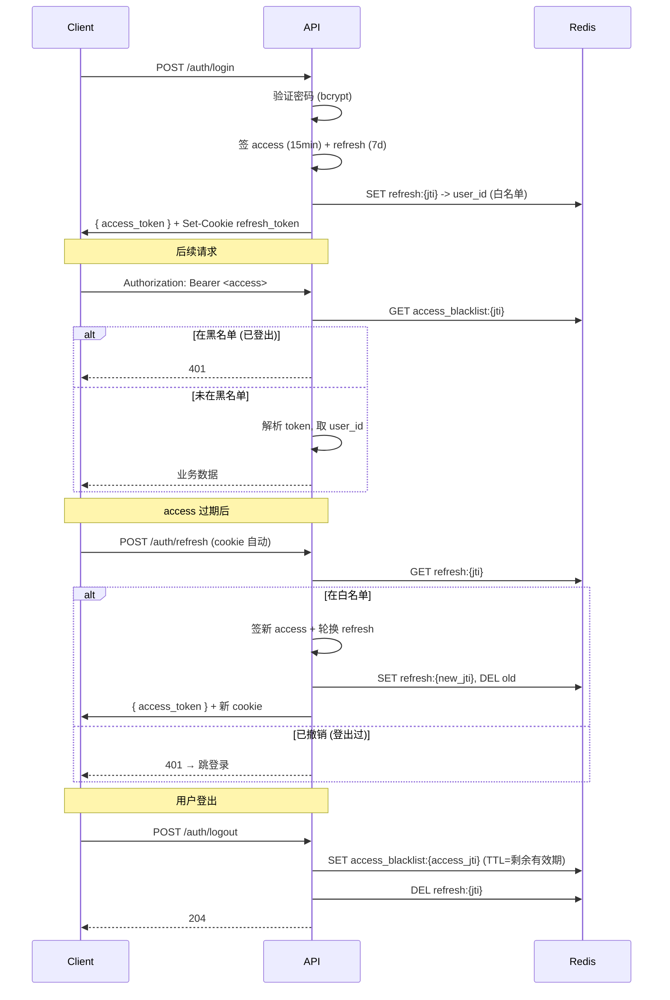
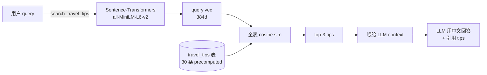
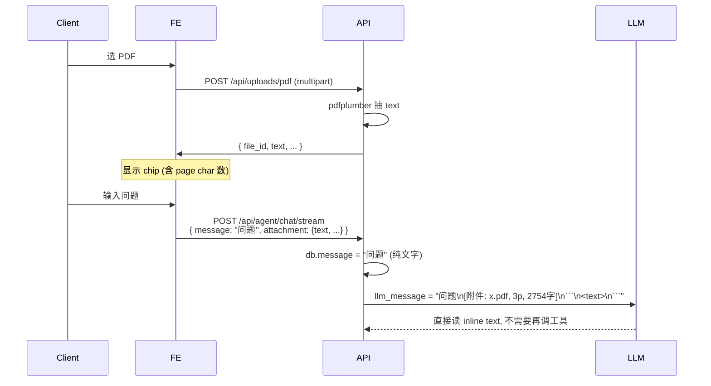
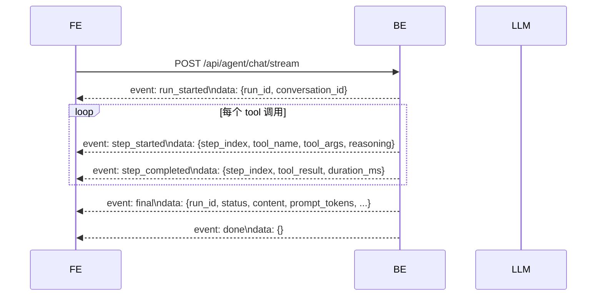
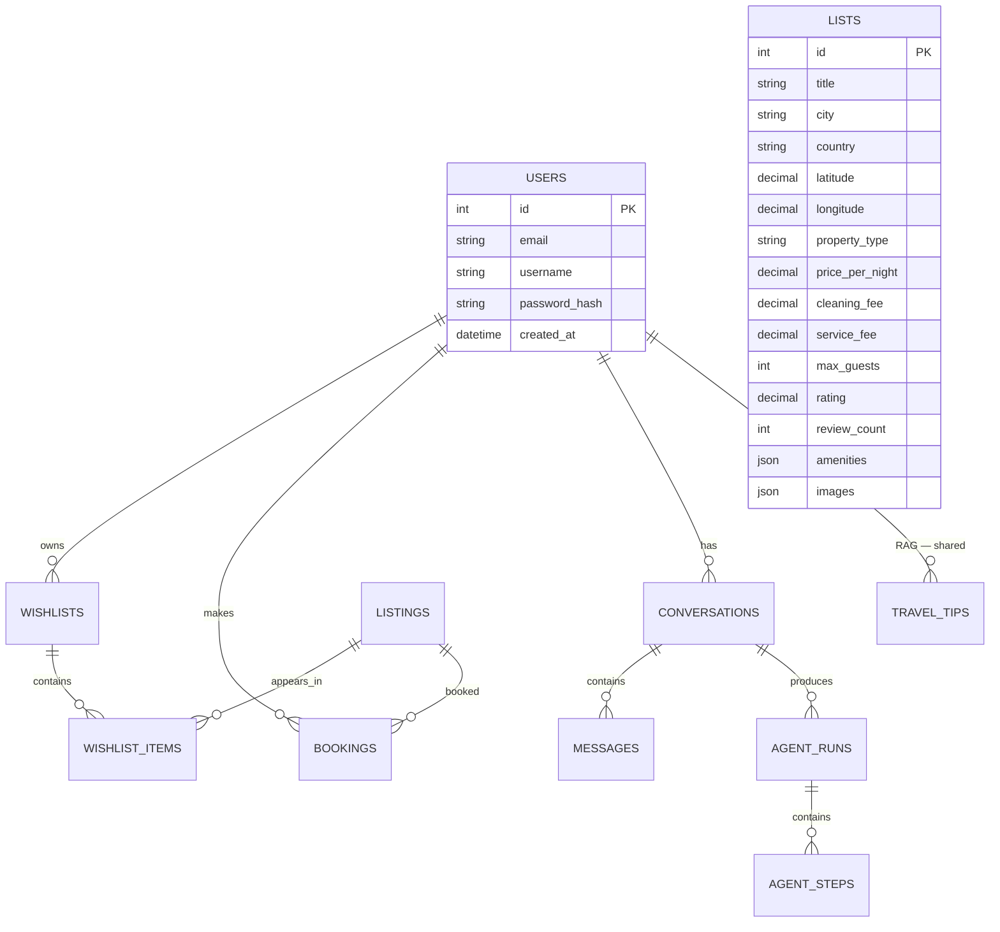

# StayAgent 架构详解

> 深入剖析各子系统设计与权衡。

---

## 1. 整体架构

```
┌─────────────────────────────────────────────────────────────────────┐
│                              Frontend (React 18 + Vite 5 + Tailwind) │
│  ┌──────────────┐ ┌──────────────┐ ┌────────────────────────────┐  │
│  │  Views/Routes│ │ Components   │ │  AgentPanel (FAB+浮+全屏)   │  │
│  │ (Router v6)  │ │ 33+          │ │  - SSE 流式                  │  │
│  │              │ │ F5 动画      │ │  - 12 tool 卡片 (F8)         │  │
│  └──────┬───────┘ └──────┬───────┘ └────────────┬───────────────┘  │
│         └──────────────────┴────────────────────┘                   │
│                            Stores (zustand)                         │
│                  auth / wishlist / agent / toast                     │
└─────────────────────────────┬───────────────────────────────────────┘
                              ▼
┌─────────────────────────────────────────────────────────────────────┐
│                          Backend (FastAPI 0.110+)                   │
│  ┌─────────────────────────────────────────────────────────────────┐│
│  │ API 层 (FastAPI router)                                          ││
│  │  /api/auth /listings /wishlists /bookings /uploads /agent       ││
│  │  - SSE: /api/agent/chat/stream                                  ││
│  │  - HITL: /api/agent/runs/{id}/confirm                           ││
│  └────────────────────────────┬────────────────────────────────────┘│
│  ┌────────────────────────────┴────────────────────────────────────┐│
│  │ Services                                                          ││
│  │  - Agent orchestrator (ReAct 循环, max 8 steps)                  ││
│  │  - 12 tool 实现 (search / compare / wishlist / booking / trips)  ││
│  │  - RAG retriever (cosine similarity)                             ││
│  │  - LLM client (DeepSeek, tenacity 重试)                         ││
│  └──────────┬───────────────────────────────┬─────────────────────┘│
│  ┌──────────┴────────────┐  ┌──────────────────┴──────────────────┐ │
│  │   SQLAlchemy ORM      │  │  外部服务                            │ │
│  │  9 张表              │  │  - MySQL 8.0+                        │ │
│  │  - users             │  │  - Redis 7+                          │ │
│  │  - listings          │  │  - DeepSeek Chat API                  │ │
│  │  - wishlists         │  │  - sentence-transformers (本地)      │ │
│  │  - bookings          │  │    (HF mirror all-MiniLM-L6-v2)      │ │
│  │  - conversations     │  │  - pdfplumber (本地 PDF 解析)        │ │
│  │  - messages          │  │                                      │ │
│  │  - agent_runs/steps   │  │                                      │ │
│  │  - travel_tips (RAG) │  │                                      │ │
│  └───────────────────────┘  └──────────────────────────────────────┘ │
└─────────────────────────────────────────────────────────────────────┘
```

---

## 2. 双 Token 鉴权 + Redis 黑名单



**为什么双 Token**：
- access 短时 (15min) 减少泄漏窗口
- refresh 长时 (7d) 但可服务端撤销 (Redis 黑名单/白名单)
- access 黑名单让 logout 即时生效，不用等过期

---

## 3. Agent Orchestrator (ReAct 循环)

```mermaid
flowchart TD
  Start([用户消息]) --> Create[创建 AgentRun + Message]
  Create --> BuildMsgs[拼 messages:<br/>system + 历史 + augment]
  BuildMsgs --> Loop{step < 8?}
  Loop -->|否| Timeout[status=timeout]
  Loop -->|是| CallLLM[调 DeepSeek chat<br/>tools=ALL_TOOL_SCHEMAS]
  CallLLM --> Resp{response}
  Resp -->|tool_calls = []<br/>or finish=stop| Final[写 final_content + Message<br/>status=completed]
  Resp -->|tool = create_booking| HITL[写 pending_tool_call<br/>status=pending_confirmation]
  Resp -->|其它 tool| Step[写 AgentStep<br/>调 tool<br/>结果喂回 LLM]
  Step --> Loop
  HITL --> Confirm([等用户 /confirm])
  Timeout --> End([end])
  Final --> End
```

**关键设计**：
- max 8 步（防失控）
- tool_error 转结构化错误喂回 LLM，让 LLM 自愈
- 创建 booking 走 HITL（前置确认），避免 agent 误下单
- LLM 调用失败 → tenacity 3 次指数退避

---

## 4. RAG 闭环



**为什么本地 embedding**：
- DeepSeek 没有公开的 embedding API
- 30 条知识库规模，全量 cosine 排序 < 50ms，无需向量 DB
- sentence-transformers 模型 ~80MB，首次启动下载到 `~/.cache/huggingface/`

**Schema**：

```sql
CREATE TABLE travel_tips (
  id BIGINT AUTO_INCREMENT,
  title VARCHAR(255),       -- "日本签证基础申请流程"
  content TEXT,           -- 完整内容
  category VARCHAR(50),    -- visa/transport/food/safety/culture
  destination VARCHAR(100),-- Japan, Tokyo (可空)
  embedding JSON,         -- 384 维 float list
  created_at DATETIME
);
```

---

## 5. PDF 上传 + attachment 通道



**关键修复**（Block 12 末尾）：
- ❌ 之前：前端把 PDF text 拼到 message body，用户气泡显示整段 PDF
- ✅ 现在：PDF text 走单独 attachment 通道
  - 用户气泡：纯文字 + 📎 chip
  - DB Message.content：纯文字
  - LLM 上下文：augment 后含 inline PDF

**为什么不让 agent 调 parse_travel_plan_pdf**：
- PDF 文本已 inline，agent 直接读更高效
- 旧 schema 让 LLM 幻觉了 `file_path` 参数（与实现 mismatch）
- 修后：schema 用 `plan_text`，实现接 `plan_text`，且 prompt 澄清"PDF 已 inline"

---

## 6. HITL (Human-in-the-loop)

```
用户: "帮我订 #5 这家"
   ↓
LLM: tool_call create_booking(listing_id=5, check_in=..., check_out=..., guests=2)
   ↓
Orchestrator 检测 tool_name == create_booking:
   ↓ 写 AgentStep (pending)
   ↓ run.status = "pending_confirmation"
   ↓ run.pending_tool_call = {tool_name, tool_args}
   ↓ run.finished_at = now
   ↓
SSE emit "pending_confirmation" event
   ↓
前端 AgentConfirmCard 弹出 (含房源/日期/合计 + 确认/取消按钮)
   ↓
用户点"确认下单" → POST /api/agent/runs/{id}/confirm {approved: true}
   ↓
后端:
   - 校验 run.status == pending_confirmation
   - 调 create_booking 工具, 写 Booking 行
   - 写新 AgentStep (含 result)
   - 写 final_content (中文 Markdown 总结)
   - run.status = "completed", pending_tool_call = null
   ↓
前端用响应替换消息 status = "completed" + 显示 final_content + AgentBookingCard
```

**为什么需要 HITL**：
- 创建订单是不可逆的（涉及真实业务）
- agent 可能误解用户意图（如日期理解错、人数算错）
- 用户复核 → 避免误下单

---

## 7. SSE 流式 + Optimistic Update



**前端处理**：
- `_applyEvent` 按 msg id 更新 zustand 状态
- 步骤折叠卡片（AgentToolStep）流式展开
- Optimistic Update：本地先显示"已下单"，等服务端响应后修正

---

## 8. F5 + F8 (Block 13)

**F5 动画**：framer-motion 11.x
- 路由切换：`<AnimatePresence mode="wait">` + `<PageTransition>`，fade + 8px slide
- 列表入场：`motion.div` + delay index stagger（首页/搜索）
- AgentMessage 渐入：y: 8 → 0，250ms
- Toast：spring 380/32
- AgentFab：whileHover scale 1.08

**F8 Generative UI**：
- 4 个 chat 专属卡片组件
  - `AgentListingCard`（search_listings 结果）
  - `AgentTipsCard`（search_travel_tips 结果，带 score 高亮）
  - `AgentBookingCard`（create_booking 确认结果，跳 /trips）
  - `AgentPlanCard`（parse_travel_plan_pdf / recommend_from_plan）
- `AgentToolStep` 按 `tool_name` 路由到对应组件
- 未知 tool → JSON 兜底（debug 友好）

---

## 9. 数据库设计



(简化版，省略部分字段。完整 schema 见 `backend/app/models/`)

---

## 10. 性能 / 安全权衡

| 维度 | 选择 | 权衡 |
|---|---|---|
| DB | MySQL InnoDB | 事务 + utf8mb4 |
| 密码 | bcrypt | 不存明文 |
| access token | JWT 15min | 短过期减少泄漏风险 |
| refresh token | HttpOnly Cookie | 防 XSS 盗取 |
| 登出 | Redis 黑名单 | 即时撤销 |
| 拖动面板 | 仅浮动模式 in-memory | 不持久化 |
| PDF 大小 | 10MB 限制 | 防止 OOM |
| embedding 模型 | 本地 384d | 速度优先 |
| LLM 重试 | 3 次指数退避 | 不无限重试 |
| tool 最大步数 | 8 步 | 防失控 |

